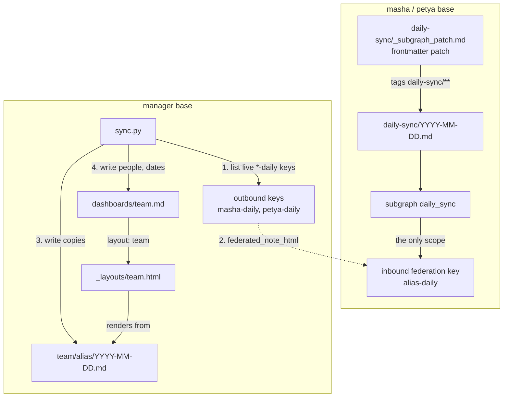

# Team status of the day over trip2g federation

Three [trip2g](https://github.com/trip2g/trip2g) knowledge bases on one machine: two employees, Masha and Petya, and their manager. Each employee base keeps one note per day with the plan, the result and whether help is needed. The manager base reads those notes through trip2g federation, copies them in, and renders a team dashboard with a custom Jet layout.

In real life an agent per employee writes the daily note. Here a setup script writes three days of invented notes, so the example runs without any AI.

[Русская версия](README.ru.md)


## How it works



## Run it

You need Docker with Compose. The image is the published `ghcr.io/trip2g/trip2g:0.11.1`, which has amd64 and arm64 builds.

```bash
docker compose up -d
docker compose logs -f setup   # ends with "wrote team/petya/<date>.md"
```

Then open http://localhost:8081/dashboards/team.

| Service | Port | What it is |
|---|---|---|
| `manager` | 8081 | The manager's base, with the dashboard |
| `masha` | 8082 | Masha's base, a sales manager |
| `petya` | 8083 | Petya's base, an accountant |
| `setup` | | One-shot: seeds notes, pairs the bases, runs the copier once |
| `sync` | | The copier, run by hand with `docker compose run --rm sync` |

## What each step does in trip2g terms

**1. Daily notes.** `setup.py` writes `daily-sync/<date>.md` into each employee base for today and the two days before, from the templates in `seed/<alias>/<days ago>.md`. Notes are written with the GraphQL mutation [`updateNotes`](https://github.com/trip2g/trip2g/blob/main/docs/en/user/update_notes.md), the documented path for scripts.

**2. Subgraph by frontmatter patch.** Each employee base also gets `daily-sync/_subgraph_patch.md`. A note with `type: frontmatter-patch` applies its Jsonnet block to every note its `include` globs match, so every daily note gets `subgraph: daily_sync` without carrying it in its own frontmatter. The subgraph is created the first time a note carrying it syncs in. The `_` prefix keeps the patch note out of listings and search. See [frontmatter patches](https://github.com/trip2g/trip2g/blob/main/docs/en/user/frontmatter-patches.md) and [subgraphs](https://github.com/trip2g/trip2g/blob/main/docs/en/user/subgraphs.md).

**3. A federation key scoped to one subgraph.** Each employee base mints an inbound federation key with kid `<alias>-daily` (`createInboundFederationSecret`) and grants it the `daily_sync` subgraph and nothing else (`addFederationSecretSubgraph`). Whoever holds that key reads the daily notes of that base and nothing more. See [federation](https://github.com/trip2g/trip2g/blob/main/docs/en/user/federation.md).

**4. The manager connects the keys.** The manager base installs each key as an outbound key (`createOutboundFederationSecret`). On install trip2g asks the peer to adopt a fresh secret, so the secret that was handed over stops working. Setup also writes a KB-note `federation/<kid>.md` with `mcp_federation_kb_url` and `mcp_federation_kb_id`, which is how the manager's MCP endpoint routes a `kb_id` to a peer.

The `-daily` suffix is a convention: the copier treats every live outbound key ending in `-daily` as one person, and the part before it as the person's alias. Connecting a new employee is one more key, with no change to the copier.

**5. The copier.** `sync.py` (Python 3, standard library only):

- lists the manager's outbound keys with `{ admin { federationSecrets { kid kbUrl revokedAt } } }` and keeps the live ones ending in `-daily`;
- for each person and each of the last three days (`DAYS` in `sync.py`) calls the MCP tool `federated_note_html` on the manager's `/_system/mcp` with `kb_id: <alias>-daily` and `path: daily-sync/<date>.md`; the manager signs the call and the employee base answers only from `daily_sync`;
- turns the HTML back into plain markdown, drops empty sections, and adds frontmatter `date`, `alias`, `person` (from the `# <date> — <name>` heading) and `help` (true unless «Нужна помощь» says «нет» or «—»);
- writes `team/<alias>/<date>.md` and `dashboards/team.md` (with `people:` and `dates:`) into the manager base with `updateNotes`.

Why copies rather than reading the peers on every page view: a layout renders from the notes of its own base, so the dashboard needs the statuses as local notes. The copies also keep the manager's history if an employee base is down.

**6. The layout.** `layout/team.html` is uploaded to the manager base as `_layouts/team.html`, also with `updateNotes`: a layout is a file in the vault like a note. `dashboards/team.md` names it with `layout: team`. The template is rendered on the server, no JavaScript: it reads `people` and `dates` from the dashboard's frontmatter, loads each copy with `nvs.ByPath("team/" + alias + "/" + day + ".md")`, takes its parts with `PartialRenderer().Section("План" | "Итог" | "Нужна помощь").ContentHTML`, highlights cells with `help: true`, writes «нет статуса» where a day is missing, and lists today's help requests on top. See [templates](https://github.com/trip2g/trip2g/blob/main/docs/en/user/templates.md) and [Jet functions](https://github.com/trip2g/trip2g/blob/main/docs/en/user/jet-functions.md).

## Re-run the copier

```bash
docker compose run --rm sync
```

It is safe to repeat: every copy is an upsert of the same path. In production you would run it on a schedule, for example from cron every hour. To see a change travel, change a daily note in an employee base with `updateNotes` and that base's token from `.env`, then run the copier again.

`docker compose run --rm setup` is also safe to repeat: it re-seeds the notes and skips pairings that already exist.

## Looking at the dashboard

`dashboards/team.md` has `free: true`, so http://localhost:8081/dashboards/team opens without signing in. That is the least ceremony for a local demo, and it has a consequence: anyone who can reach the manager base reads the whole team's statuses on that page, because `nvs.ByPath` returns a note whatever its access settings. The copies under `team/` stay private on their own URLs. On a real base drop `free: true` and put the dashboard in a subgraph only the manager is granted.

## Things this example does differently from production

- **Credentials.** Each instance seeds an owner personal token from `OWNER_PERSONAL_TOKEN_VALUE` at boot, and the scripts use it as `Authorization: Bearer`. The values in `.env` and the `JWT_SECRET` and `DATA_ENCRYPTION_KEY` in `docker-compose.yml` are fixed, public placeholders. Generate your own for anything that is not this demo.
- **The handover key.** Normally the employee sends the manager one packed handover key, and the manager pastes it as `key`. That key carries the issuing base's `PUBLIC_URL`, here `http://localhost:8082`, which inside the manager's container is the manager itself, so installing it fails with `the peer did not answer: ... dial tcp4 127.0.0.1:8082: connect: connection refused`. Setup therefore uses the documented three-field form, `kid` + `secretHex` + `kbURL`, with the in-network address `http://masha:8080/_system/mcp`. Rotation on install still happens.
- **Plain HTTP between bases.** Rotation refuses `http://` peers unless the instance runs with `MCP_FEDERATION_ALLOW_PRIVATE=true`, which the compose file sets. Use HTTPS peer URLs in production.
- **Storage.** `STORAGE_BACKEND=local` keeps files in the data volume, so no S3 service is needed.
- **Dates.** "Today" is the UTC date inside the script container.

## Clean up

```bash
docker compose down -v
```

This stops all containers and deletes the three data volumes.

## Files

| File | What it is |
|---|---|
| `docker-compose.yml` | Three trip2g instances, `setup` and `sync` |
| `.env` | The three owner tokens, local placeholders |
| `setup.py` | Seeds notes, mints and connects the keys, uploads the layout, runs the copier |
| `sync.py` | The copier |
| `seed/` | The frontmatter patch and the daily notes, `{date}` filled in at run time |
| `layout/team.html` | The dashboard layout |
