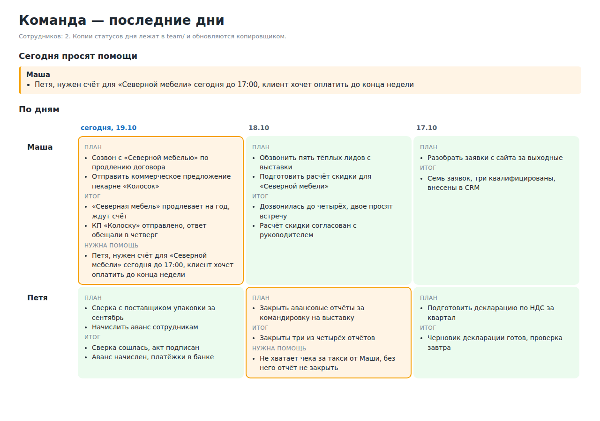
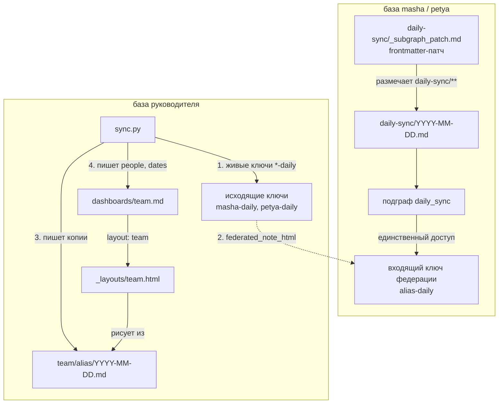

# Статус дня команды через федерацию trip2g

Три базы знаний [trip2g](https://github.com/trip2g/trip2g) на одной машине: сотрудники Маша и Петя и их руководитель. В базе сотрудника на каждый день лежит заметка: план, итог и нужна ли помощь. База руководителя читает эти заметки через федерацию trip2g, копирует к себе и рисует дашборд команды своим Jet-шаблоном.

В жизни заметку дня пишет агент сотрудника. Здесь её пишет скрипт установки, на три дня назад, с выдуманным текстом, так что пример работает без ИИ.

Подробности, что именно происходит на каждом шаге, в [README.md](README.md).



## Как это устроено



## Запуск

Нужен Docker с Compose. Образ `ghcr.io/trip2g/trip2g:0.11.1` собран под amd64 и arm64.

```bash
docker compose up -d
docker compose logs -f setup   # в конце "wrote team/petya/<дата>.md"
```

Дашборд: http://localhost:8081/dashboards/team. Базы: руководитель на 8081, Маша на 8082, Петя на 8083.

## Шаги в терминах trip2g

1. **Заметки дня.** `setup.py` пишет в базу сотрудника `daily-sync/<дата>.md` за сегодня и два дня до, из шаблонов `seed/<alias>/<дней назад>.md`, мутацией GraphQL `updateNotes`.
2. **Подграф через frontmatter-патч.** Заметка `daily-sync/_subgraph_patch.md` с `type: frontmatter-patch` ставит всем заметкам под `daily-sync/**` `subgraph: daily_sync`. Подграф появляется сам, когда синхронизируется первая заметка с ним.
3. **Ключ федерации на один подграф.** База сотрудника выпускает входящий ключ с kid `<alias>-daily` и даёт ему только подграф `daily_sync`.
4. **Руководитель подключает ключи** как исходящие. При установке trip2g меняет секрет на новый, и тот, что передавали, перестаёт работать. KB-заметка `federation/<kid>.md` говорит MCP руководителя, куда вести `kb_id`. Суффикс `-daily` это договорённость: копировщик считает каждый живой исходящий ключ на `-daily` одним сотрудником.
5. **Копировщик** `sync.py` (Python 3, только стандартная библиотека) берёт живые ключи `-daily`, за последние три дня (`DAYS`) читает `daily-sync/<дата>.md` MCP-инструментом `federated_note_html`, переводит HTML обратно в markdown, выкидывает пустые разделы и пишет `team/<alias>/<дата>.md` с `date`, `alias`, `person`, `help` и `dashboards/team.md` с `people` и `dates`.
6. **Шаблон.** `layout/team.html` загружается в базу руководителя как `_layouts/team.html` тем же `updateNotes`. Он рисует сетку «люди × дни» на сервере, без JavaScript, через `nvs.ByPath` и `PartialRenderer().Section(...)`, подсвечивает `help: true`, пишет «нет статуса» за пропущенный день и выводит сегодняшние просьбы о помощи сверху.

## Повторить копирование

```bash
docker compose run --rm sync
```

Повторять можно сколько угодно: каждая копия перезаписывает тот же путь. В жизни это расписание, например cron раз в час.

## Что здесь не как в проде

- У дашборда `free: true`, поэтому он открывается без входа. Значит, любой, кто достучится до базы руководителя, видит статусы всей команды на этой странице. Сами копии в `team/` закрыты. В настоящей базе уберите `free: true` и положите дашборд в подграф, доступный только руководителю.
- Токены в `.env`, `JWT_SECRET` и `DATA_ENCRYPTION_KEY` в `docker-compose.yml` это публичные заглушки для демо.
- Обычно сотрудник передаёт руководителю один упакованный ключ. В нём адрес `PUBLIC_URL` базы, здесь `http://localhost:8082`, а внутри контейнера руководителя это он сам, и установка падает с `connection refused`. Поэтому скрипт ставит ключ задокументированной формой из трёх полей, `kid` + `secretHex` + `kbURL`, с адресом внутри сети `http://masha:8080/_system/mcp`.
- Базы говорят друг с другом по HTTP, для этого `MCP_FEDERATION_ALLOW_PRIVATE=true`. В проде нужен HTTPS.

## Убрать за собой

```bash
docker compose down -v
```
